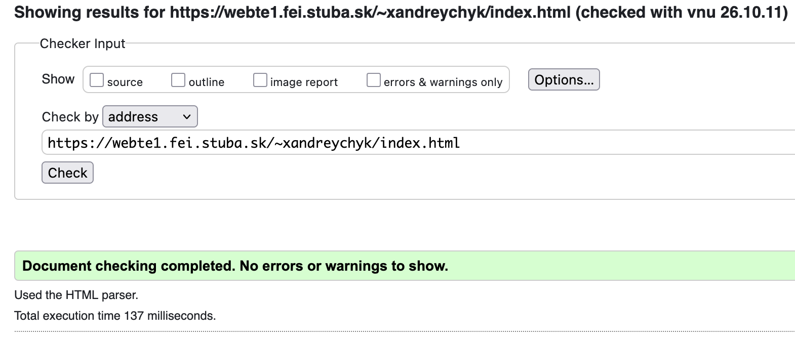
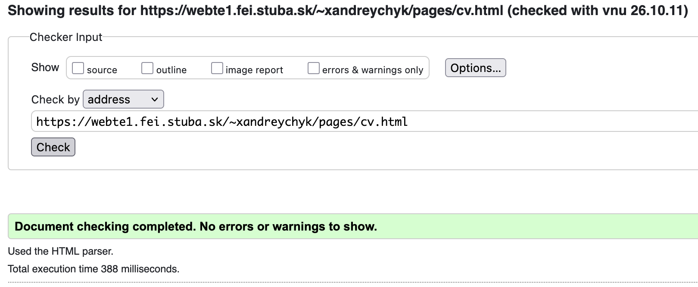
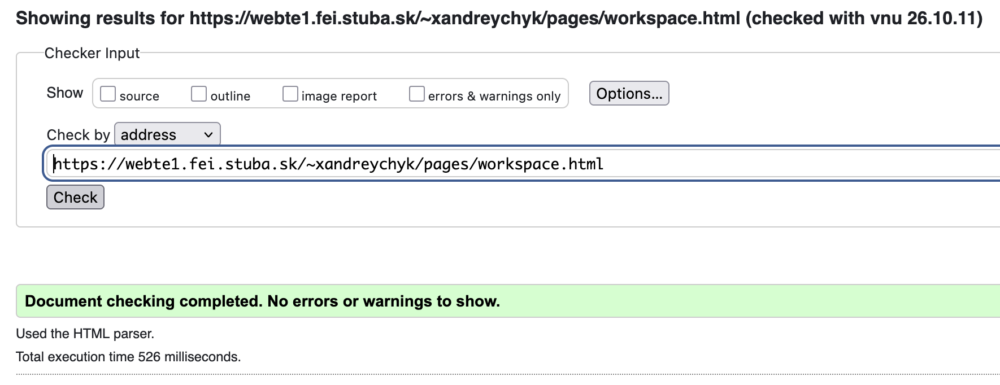
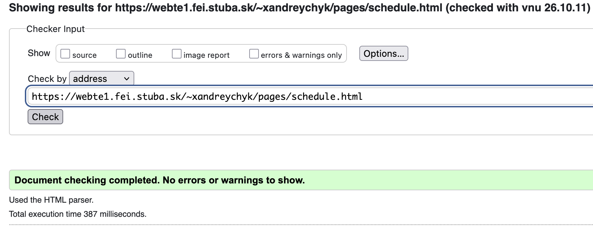
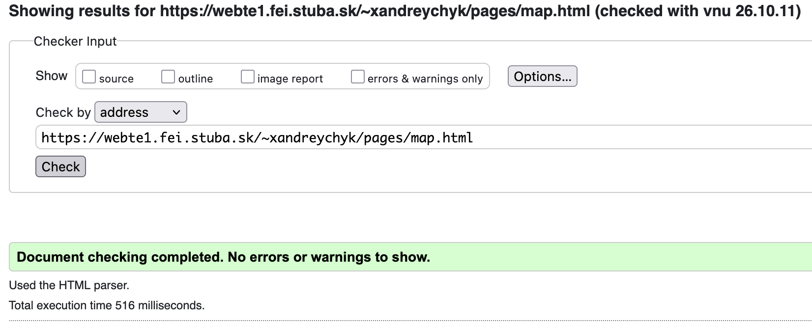

# Z1 – Moja online vizitka

**Viktor Andreychyk**, FEI STU, aplikovaná informatika, krúžok 3
Predmet: Webové technológie 1, zadanie č. 1, ZS 2026/2027

**Odkaz na stránku na školskom serveri:** https://webte1.fei.stuba.sk/~xandreychyk/index.html

## O čom web je

Osobná vizitka z piatich podstránok: profil, životopis, interaktívny obrázok môjho
pracovného stola, rozvrh na zimný semester 2026/2027 a mapa s fakultou a bydliskom.
Celý web stojí na jednom spoločnom `css/styles.css` a jednom `js/script.js`, bez
knižníc a frameworkov – jedinou výnimkou je mapová knižnica Leaflet na `map.html`.
Stránka je ovládateľná aj samotnou klávesnicou.

## Štruktúra

```
Z1_Andreychyk/
├── index.html            profil
├── pages/                cv.html, workspace.html, schedule.html, map.html
├── css/                  styles.css (dizajnový systém), print.css (tlač životopisu)
├── js/script.js          hotspoty, rozvrh, mapa, menu
├── fonts/                Poppins 400/500/600/700 (.woff2, lokálne)
├── img/                  me.jpg, workspace.jpg, og-cover.png, apple-touch-icon.png
├── vendor/leaflet/       mapová knižnica (lokálne, bez CDN)
└── favicon.ico           monogram VA
```

## Zdroje a licencie

| Zdroj | Pôvod | Licencia |
| --- | --- | --- |
| Portrét `img/me.jpg` | vlastná ilustrácia (SVG prevedené do JPG) | vlastné dielo |
| Fotografia stola `img/workspace.jpg` | vlastná fotografia (upravený jas a kontrast) | vlastné dielo |
| Monogram a `favicon.ico` | vlastná tvorba | vlastné dielo |
| Písmo Poppins | [Indian Type Foundry, Jonny Pinhorn](https://fonts.google.com/specimen/Poppins) | SIL Open Font License 1.1 |
| Knižnica Leaflet 1.9.4 | [leafletjs.com](https://leafletjs.com/) | BSD 2-Clause, kópia v `vendor/leaflet/LICENSE.txt` |
| Mapové podklady | [OpenStreetMap](https://www.openstreetmap.org/copyright) | ODbL |
| Údaje v rozvrhu | môj rozvrh z AIS, ZS 2026/2027 | – |

Písmo je vložené lokálne cez `@font-face`, žiadny externý odkaz na Google Fonts.
Podmnožiny `latin` a `latin-ext` sú spojené do jedného súboru na každú váhu, aby
fungovala slovenská diakritika.

## Responzivita a zariadenia

Layout je postavený na fluidnom kontajneri (`min()` + automatické okraje) a na
relatívnych jednotkách, takže sa neláme pri žiadnej šírke. Na úzkych displejoch nevzniká vodorovné rolovanie.

- `@media (max-width: 768px)` – hamburger menu, jednostĺpcový životopis,
  panely obrázka sa presunú pod fotku.
- Veľkosti písma sú `clamp()`, takže sa škálujú plynulo bez zlomov.
- Rozvrh sa na úzkych displejoch posúva do strán vo vlastnom kontajneri,
  stránka pod ním zostáva na mieste.

## Súkromie

Telefónne číslo a e-mailová adresa na stránke sú fiktívne, uvedené len v platnom
formáte. Poloha bydliska je zaokrúhlená na areál internátu Mladosť (Staré grunty 53),
nie na konkrétnu izbu.

## Validácia







## Použitie AI nástrojov

Na tomto zadaní som použil AI asistenta – pomáhal mi s návrhom
dizajnového systému v CSS, s kostrou JavaScriptu a s formuláciou textov.

